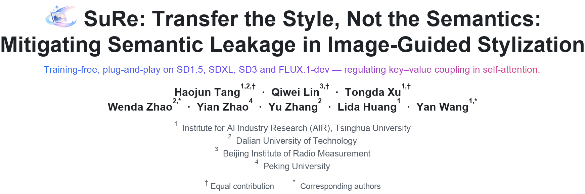
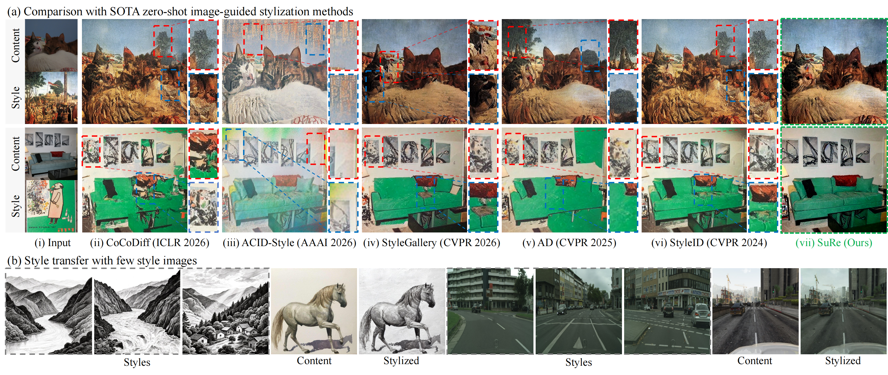
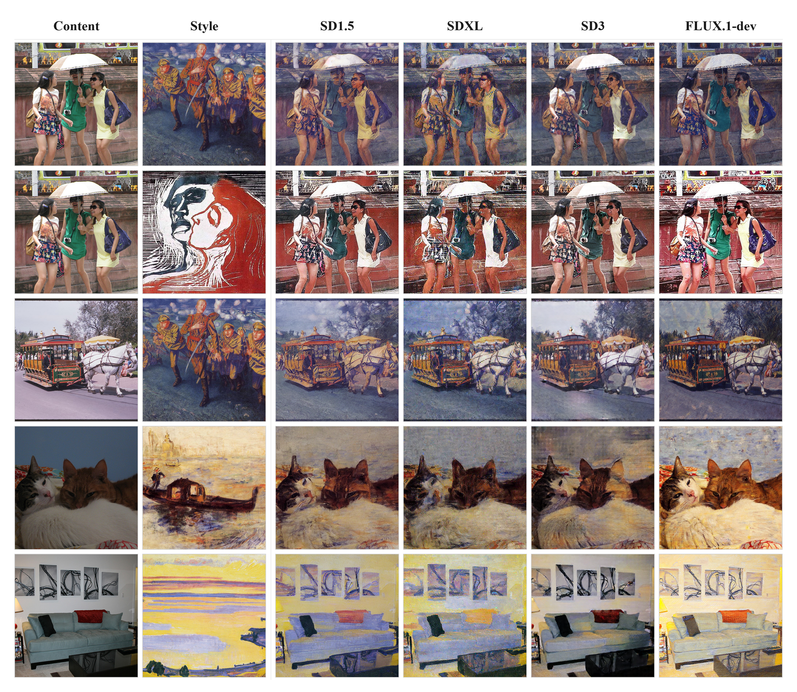
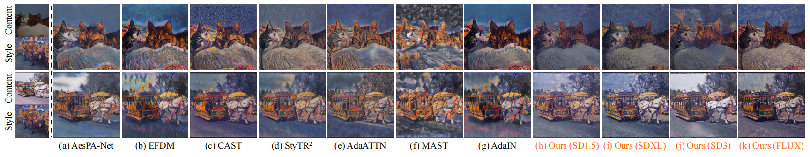
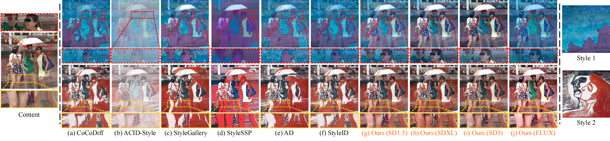
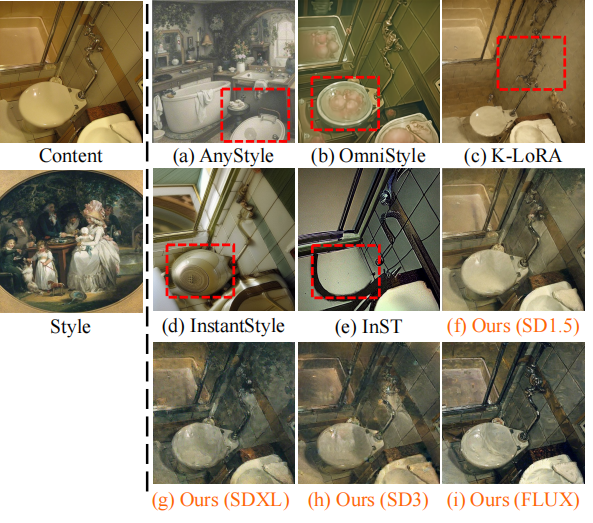
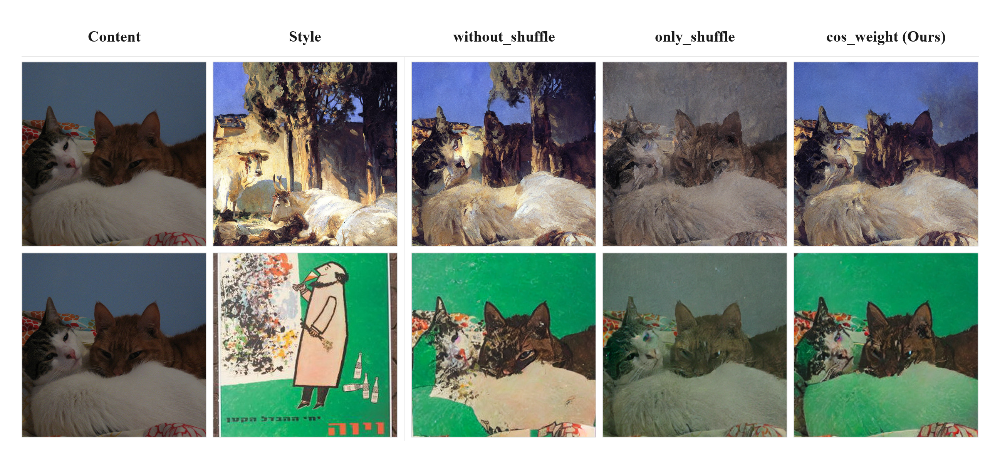

<p align="center">
  <picture>
    <source media="(prefers-color-scheme: dark)" srcset="asserts/header_dark_v3.png">
    
  </picture>
</p>

<p align="center">
  <a href="https://xinr-tang.github.io/SuRe-homepage/"></a>
  <a href="https://arxiv.org/abs/2511.06365"></a>
  <a href="https://www.python.org/"></a>
  <a href="LICENSE"></a>
</p>

<p align="center">
  
</p>

---

## 🔥🔥🔥 News
- **[2026-11-09]** 🚀 **Code release.** The official training-free implementation of SuRe is now public: single-image, batch and multi-style stylization on SD1.5, SDXL, SD3 and FLUX.1-dev.
- **[2026-11-09]** 📄 **Paper available.** See [Transfer the Style, Not the Semantics: Mitigating Semantic Leakage in Image-Guided Stylization](https://arxiv.org/abs/2511.06365).

---

## Overview

Zero-shot image-guided style transfer aims to transfer stylistic characteristics from a reference image to a content image while preserving its original semantic structure. Recent diffusion-based methods achieve this by combining content queries with style keys and values through self-attention. **However, such methods often suffer from semantic leakage, where unintended semantic information from the style image is transferred into the stylized output.** We revisit this problem from the perspective of **key–value coupling, revealing that the native correspondence between style keys and values allows stylistic and semantic information to be transferred together.**

To address this issue, we propose **SuRe (Semantic Uncoupling and Recoupling)**, a timestep-aware key–value regulation framework for faithful image-guided stylization. SuRe introduces **Value Shuffle (V-Shuffle), which randomly permutes style value tokens while keeping style keys fixed, breaking their native correspondence while preserving the empirical value distribution.** Building upon this, we develop a **Progressive Recoupling Mechanism (PRM) that dynamically regulates key–value coupling during stylized-latent optimization.** By emphasizing semantic uncoupling in early optimization steps and progressively restoring coupling in later steps, SuRe effectively suppresses semantic leakage while maintaining content structure and transferring the desired style.

---

## 🖼️ Representative Results

<p align="center">
  
</p>
<p align="center"><em>Fig.1 Stylization results on SD1.5, SDXL, SD3 and FLUX.1-dev.</em></p>

<p align="center">
  
</p>
<p align="center"><em>Fig.2 Comparison with feed-forward methods.</em></p>

<p align="center">
  
</p>
<p align="center"><em>Fig.3 Comparison with diffusion attention methods.</em></p>

<p align="center">
  
</p>
<p align="center"><em>Fig.4 Comparison with diffusion adaptation methods.</em></p>

---

## 🛠️ Installation

SuRe is a small, self-contained package built on Hugging Face [Diffusers](https://github.com/huggingface/diffusers).

```bash
git clone https://github.com/XinR-Tang/SuRe.git
cd SuRe

conda create -n sure python=3.10 -y
conda activate sure
pip install -r requirements.txt
```

Download the backbones you need ([SD1.5](https://huggingface.co/stable-diffusion-v1-5/stable-diffusion-v1-5),
[SDXL-base-1.0](https://huggingface.co/stabilityai/stable-diffusion-xl-base-1.0),
[SD3-medium](https://huggingface.co/stabilityai/stable-diffusion-3-medium-diffusers),
[FLUX.1-dev](https://huggingface.co/black-forest-labs/FLUX.1-dev)) from Hugging Face and point
`model_path` in [`sure/config.py`](sure/config.py) at the local checkpoint directories.

## 🚀 Quick Start

### 1. Single-style transfer
Use the following commands to stylize one content-style pair:

```bash
cd SuRe

EXAMPLE=single-example1 \
MODEL=sd1_5 \
bash scripts/run_single_stylization.sh
```

Representative content/style pairs save in the `example/` folder —
`single-example1` to `single-example5` for single-reference stylization.

The backbone is selected with `MODEL` (equivalently `--model`). Four flags are
supported — `sd1_5` (the default), `sdxl`, `sd3` and `flux` — and each one brings
its own defaults for resolution, self-attention layers and the V-Shuffle / PRM
hyper-parameters:

<div align="center">

| Backbone   | Resolution | Self-attention layers |   lr  |  β   | m | Steps |
|:-----------|:----------:|:---------------------:|:-----:|:----:|:-:|:-----:|
| SD1.5      |  512×512   |         10–16         |  0.05 | 0.24 | 5 |  200  |
| SDXL       | 1024×1024  |         50–57         |  0.02 | 0.30 | 5 |  200  |
| SD3        |  512×512   |         17–23         | 0.015 | 0.22 | 5 |  200  |
| FLUX.1-dev |  512×512   |         50–57         |  0.02 | 0.25 | 5 |  200  |

</div>

All defaults save in [`sure/config.py`](sure/config.py) and can be overridden from
the command line, e.g. `--model sdxl --lr 0.02 --beta 0.30`.

### 2. Multi-style transfer

SuRe also accepts a folder of style images instead of a single style image, passed
with `--style_image_folder`. `scripts/run_multi_stylization.sh` wraps this:

```bash
cd SuRe

EXAMPLE=multi-example \
MODEL=sd1_5 \
bash scripts/run_multi_stylization.sh
```

The script processes three reference sets in `example/multi-example/`: `sty-1`, `sty-3`, and `sty-5`, containing 1, 3, and 5 style images, respectively. All images in each set belong to the same style domain and are used together to stylize the shared content image `cnt.jpg`. This allows the model to capture their common stylistic features (e.g., colors, brushstrokes, and textures) without copying the semantic content of individual references.

The generated images are saved in the same directory as `sd1_5_sty1.png`, `sd1_5_sty3.png`, and `sd1_5_sty5.png`, respectively. To use other models (`sdxl`, `sd3`, or `flux`), simply change the `MODEL` parameter without modifying the command.

### 3. Effect of the Coupling Mode

The key–value correspondence is controlled by `--mode`, which accepts three
values:

- `without_shuffle` — keep the native style key–value pairing (no V-Shuffle),
  i.e. the native self-attention distillation.
- `only_shuffle` — permute the style values while keeping the style keys fixed,
  with no recoupling during sampling.
- `cos_weight` (default) — V-Shuffle together with the progressive recoupling mechanism (PRM), i.e. the full SuRe.

Run the three modes on the same content/style pair:

```bash
# 1) native key-value pairing, no V-Shuffle
MODEL=sd1_5 EXAMPLE=comparison1 \
OUTPUT_PATH=example/comparison1/without_shuffle.png \
bash scripts/run_single_stylization.sh --mode "without_shuffle"

# 2) V-Shuffle only, no recoupling
MODEL=sd1_5 EXAMPLE=comparison1 \
OUTPUT_PATH=example/comparison1/only_shuffle.png \
bash scripts/run_single_stylization.sh --mode "only_shuffle"

# 3) V-Shuffle + progressive recoupling (full SuRe, default)
MODEL=sd1_5 EXAMPLE=comparison1 \
OUTPUT_PATH=example/comparison1/cos_weight.png \
bash scripts/run_single_stylization.sh --mode "cos_weight"
```

<p align="center">
  
</p>

Both rows are produced from `example/comparison1` and `example/comparison2`.
Keeping the native pairing (`without_shuffle`) transfers the semantics of the
style image together with its appearance, so the semantic of the style image leaks
into the stylized image. Permuting values alone (`only_shuffle`) breaks that
association and preserves the low-level colour distribution. `cos_weight` sits between the two: it mitigates semantic leakage
while keeping the style.

## Citation
If you find our work useful, please consider citing our paper:
```bibtex
@article{tang2025sure,
  title   = {Transfer the Style, Not the Semantics: Mitigating Semantic Leakage in Image-Guided Stylization},
  author  = {Tang, Haojun and Lin, Qiwei and Xu, Tongda and Zhao, Wenda and Zhao, Yian and Zhang, Yu and Huang, Lida and Wang, Yan},
  journal = {arXiv preprint arXiv:2511.06365},
  year    = {2025}
}
```

## License
Released under the [MIT License](LICENSE).
